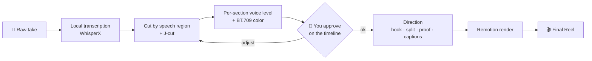

<div align="center">

[🇧🇷 Português](README.md) · **🇺🇸 English** · [🇪🇸 Español](README.es.md) · [🇫🇷 Français](README.fr.md)

# 🎬 Reel CCB

### You record. Claude Code edits the Reel.

A vertical Reel editing skill (9:16 talking head) for [Claude Code](https://claude.com/claude-code).<br>
It cuts the mistakes, levels the voice, fixes the color and builds the hook, split screen, on-screen proof and captions. All from one sentence in the terminal.


<br>


<sub><b>Left:</b> the raw take, straight from the phone. <b>Right:</b> the same section after the skill.</sub>

</div>

---

## Contents

- [What it does on a real take](#what-it-does-on-a-real-take)
- [Gallery](#gallery)
- [How it works](#how-it-works)
- [The 3 laws](#the-3-laws)
- [Requirements](#requirements)
- [Install](#install)
- [Usage](#usage)
- [Inside: `edit-data.json`](#inside-edit-datajson)
- [What's in the repo](#whats-in-the-repo)
- [Gotchas already handled](#gotchas-already-handled)
- [FAQ](#faq)
- [Troubleshooting](#troubleshooting)
- [Contributing](#contributing)

> The demo Reel is in Brazilian Portuguese. The skill works in any language Whisper transcribes.

---

## What it does on a real take

The Reel above was edited end to end by the skill. These numbers come from that edit:

| | |
|---|---|
| ⏱️ **Length** | 64.0s raw → **53.6s** Reel |
| ✂️ **Cut** | mistakes, retakes and silences removed by speech regions measured in the audio, with J-cuts between blocks |
| 🎚️ **Voice** | level fixed per section: the voice that drops at the end of a sentence comes back up |
| 🎨 **Color** | grade applied and re-tagged as BT.709 so it doesn't blow out on Instagram |
| 🧩 **Direction** | written hook, split screens, text behind the speaker, on-screen proof, word-by-word captions |
| ✅ **Approval** | you approve the cut on a browser timeline before any graphics go in |

---

## Gallery

<table>
<tr>
<td align="center" width="50%"><br><b>Hook behind the head</b><br><sub>Frame 1 is already the cover. The speaker is matted and the text passes behind them.</sub></td>
<td align="center" width="50%"><br><b>Split screen</b><br><sub>Supporting footage goes below; the face never leaves the screen.</sub></td>
</tr>
<tr>
<td align="center"><br><b>On-screen proof</b><br><sub>Every verifiable claim shows up the moment it is said.</sub></td>
<td align="center"><br><b>Closing CTA</b><br><sub>Big keyword, ready for DM automation.</sub></td>
</tr>
</table>

---

## How it works



Two phases, two skills:

- **`motor-reel` (Phase 1, engineering):** transcribes, finds the real edges of each phrase, cuts, joins with J-cuts, measures and fixes each section's level, applies color and **verifies the cut numerically** before you watch it.
- **`reel-ccb` (Phase 2, direction):** decides what appears on screen. The whole edit lives in a single `edit-data.json`; the Remotion template never changes.

---

## The 3 laws

Every Reel that comes out of here follows these three rules:

1. **The speaker never leaves the screen.** Under 2% of the time without them. The default is split, not full-screen b-roll.
2. **The background is never flat black.** Every overlay uses the speaker's own blurred environment.
3. **The first 2 seconds are the speaker talking with the written hook behind them.** Never open with a logo or b-roll: frame 1 is the feed thumbnail.

---

## Requirements

| | |
|---|---|
| OS | macOS (tested). Linux and Windows are supported by the engine but not yet tested with this skill |
| Agent | [Claude Code](https://claude.com/claude-code) |
| Tools | `ffmpeg`, `uv`, Node.js 18+ |
| Disk | ~2 GB on first install (WhisperX + torch) |
| API key | **none** to cut, transcribe and build |

---

## Install

```bash
git clone https://github.com/bisnishub/reel-ccb
cp -R reel-ccb/skills/* ~/.claude/skills/

brew install ffmpeg uv node

cd ~/.claude/skills/motor-reel
uv sync                      # ~2 GB the first time, runs 100% locally
uv sync --extra matting      # optional: "text behind the speaker" effect
```

## Usage

Open Claude Code in the video's folder and ask:

```text
edit this reel: ./take01.mp4
```

```text
cut my mistakes and build the reel, the hook is "China just open-sourced the secret of AI"
```

```text
add a split with ./broll/demo.mp4 when I say "repository"
```

Claude runs Phase 1, opens the timeline in your browser so you can approve the cut and, once you say ok, builds Phase 2 and delivers `final.mp4`.

---

## Inside: `edit-data.json`

A Reel's whole direction fits in one file. Claude writes it; you can tweak it by hand:

```json
{
  "hook": {
    "style": "outline",
    "endSec": 4.0,
    "lines": ["CHINA JUST OPENED", "THE SECRET OF AI"]
  },
  "camera": { "enabled": true, "zooms": [1.1, 1.16, 1.12], "pushIn": 0.04 },
  "captions": { "enabled": true, "style": "karaoke", "maxWords": 3 },
  "splitInserts": [
    { "src": "brolls/demo.mp4", "start": 6.6, "end": 10.6, "fit": "cover", "bandH": 620 }
  ]
}
```

Full schema in [`skills/motor-reel/references/shortform.md`](skills/motor-reel/references/shortform.md).

---

## What's in the repo

```
skills/
├── reel-ccb/            # direction: laws, techniques, pacing, gotchas, checklist
│   └── SKILL.md
└── motor-reel/          # engine: cut, voice, color, verification, preview, Remotion template
    ├── SKILL.md
    ├── helpers/         # transcribe, speech_regions, voice_levels, verify_cut, render...
    ├── assets/          # preview UI + shortform/longform templates
    └── references/      # Phase 2 schema and gotchas
```

> The `reel-ccb` skill is written in Portuguese. Claude reads it fine and answers in your language.

## Gotchas already handled

Each of these cost hours on a real edit. The skill already knows about them:

- **The Remotion render comes back with the wrong color tags** (`pc/bt470bg`, about 20% more saturated). The skill re-tags it to `tv/bt709`.
- **The render is already clipping** (+0.40 dBTP before any music), so the final loudnorm is mandatory.
- **Overlay timing comes from `jcut_timeline`**, not from summing segments. Summing is off by 234ms and every graphic lands early.
- **Whisper timestamps are not cut points.** Edges come from speech regions measured in the audio.

---

## FAQ

<details>
<summary><b>Does it work in languages other than Portuguese?</b></summary>

Yes. Transcription is multilingual. Say the language in your request ("edit this reel in English") so the skill passes `--language en` and skips auto-detection.
</details>

<details>
<summary><b>Do I need a GPU?</b></summary>

No. It runs on CPU and Apple Silicon. The first transcription takes longer because the models download.
</details>

<details>
<summary><b>Does my video leave my machine?</b></summary>

No. Transcription, cutting and rendering run locally. The only external service is Claude itself, which reads the transcript text, not the video.
</details>

<details>
<summary><b>Does it handle horizontal video?</b></summary>

The engine supports 16:9 (longform template). This skill's direction is designed for 9:16.
</details>

<details>
<summary><b>Can I use it with Codex or another agent?</b></summary>

The engine follows the standard skill layout (`SKILL.md` + `helpers/`). Copy the folders into your agent's skills directory.
</details>

---

## Troubleshooting

| Symptom | Cause | Fix |
|---|---|---|
| `ffmpeg: command not found` | ffmpeg not on PATH | `brew install ffmpeg` |
| `yt-dlp not on PATH` / import error | stale venv | `cd ~/.claude/skills/motor-reel && uv sync` |
| Text behind the speaker doesn't show | matting extra not installed | `uv sync --extra matting` |
| Final Reel more saturated than the cut | Remotion color tags | handled by the skill; check `final_bt709.mp4` |
| Overlays landing early | `segments.json` summed by hand | generate it from `jcut_timeline` |

---

## Contributing

Issues and PRs welcome. If your edit uncovered a new gotcha, open an issue with the symptom and how you measured it, the same way the skill's own gotchas are written.

---

<div align="center">

Made by **[Bisnis HUB](https://bisnishub.com.br)**

<sub>Cutting engine based on <a href="https://github.com/fillrochaa/edvid">edvid</a> (MIT). License in <code>skills/motor-reel/LICENSE</code>.</sub>

</div>
