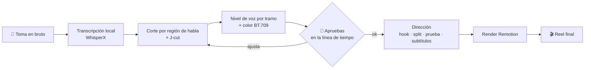

<div align="center">

[🇧🇷 Português](README.md) · [🇺🇸 English](README.en.md) · **🇪🇸 Español** · [🇫🇷 Français](README.fr.md)

# 🎬 Reel CCB

### Tú grabas. Claude Code edita el Reel.

Skill de edición de Reel vertical (talking head 9:16) para [Claude Code](https://claude.com/claude-code).<br>
Corta los errores, nivela la voz, corrige el color y arma el hook, el split screen, la prueba en pantalla y los subtítulos. Todo a partir de una frase en la terminal.


<br>


<sub><b>Izquierda:</b> la toma en bruto, tal como salió del celular. <b>Derecha:</b> el mismo tramo después de la skill.</sub>

</div>

---

## Índice

- [Qué hace en una toma real](#qué-hace-en-una-toma-real)
- [Galería](#galería)
- [Cómo funciona](#cómo-funciona)
- [Las 3 leyes](#las-3-leyes)
- [Requisitos](#requisitos)
- [Instalar](#instalar)
- [Usar](#usar)
- [Por dentro: `edit-data.json`](#por-dentro-edit-datajson)
- [Qué hay en el repo](#qué-hay-en-el-repo)
- [Gotchas ya resueltos](#gotchas-ya-resueltos)
- [Preguntas frecuentes](#preguntas-frecuentes)
- [Problemas comunes](#problemas-comunes)
- [Contribuir](#contribuir)

> El Reel de demostración está en portugués de Brasil. La skill funciona en cualquier idioma que Whisper transcriba.

---

## Qué hace en una toma real

El Reel de arriba fue editado de principio a fin por la skill. Los números son de esa edición:

| | |
|---|---|
| ⏱️ **Duración** | 64,0 s en bruto → **53,6 s** de Reel |
| ✂️ **Corte** | errores, repeticiones y silencios eliminados por regiones de habla medidas en el audio, con J-cut entre bloques |
| 🎚️ **Voz** | nivel corregido por tramo: la voz que cae al final de la frase vuelve a su lugar |
| 🎨 **Color** | grade aplicado y reetiquetado en BT.709 para que no se queme en Instagram |
| 🧩 **Dirección** | hook escrito, split screens, texto detrás de la persona, prueba en pantalla, subtítulos palabra por palabra |
| ✅ **Aprobación** | apruebas el corte en una línea de tiempo en el navegador antes de que entre cualquier gráfico |

---

## Galería

<table>
<tr>
<td align="center" width="50%"><br><b>Hook detrás de la cabeza</b><br><sub>El frame 1 ya es la portada. La persona se recorta y el texto pasa por detrás.</sub></td>
<td align="center" width="50%"><br><b>Split screen</b><br><sub>El material de apoyo entra abajo y el rostro nunca sale de la pantalla.</sub></td>
</tr>
<tr>
<td align="center"><br><b>Prueba en pantalla</b><br><sub>Cada afirmación verificable aparece en el momento en que se dice.</sub></td>
<td align="center"><br><b>CTA de cierre</b><br><sub>Palabra clave grande, lista para automatizar DMs.</sub></td>
</tr>
</table>

---

## Cómo funciona



Dos fases, dos skills:

- **`motor-reel` (Fase 1, ingeniería):** transcribe, encuentra los bordes reales de cada frase, corta, une con J-cut, mide y corrige el nivel de cada tramo, aplica color y **verifica el corte numéricamente** antes de que lo veas.
- **`reel-ccb` (Fase 2, dirección):** decide qué aparece en pantalla. Toda la edición vive en un único `edit-data.json`; la plantilla de Remotion no cambia.

---

## Las 3 leyes

Todo Reel que sale de aquí sigue estas tres reglas:

1. **La persona nunca sale de la pantalla.** Menos del 2% del tiempo sin ella. Lo normal es split, no b-roll a pantalla completa.
2. **El fondo nunca es negro plano.** Todo overlay usa el propio entorno desenfocado.
3. **Los 2 primeros segundos son la persona hablando con el hook escrito detrás.** Nunca se abre con logo ni b-roll: el frame 1 es la miniatura del feed.

---

## Requisitos

| | |
|---|---|
| Sistema | macOS (probado). Linux y Windows están soportados por el motor, pero aún no se probaron con esta skill |
| Agente | [Claude Code](https://claude.com/claude-code) |
| Herramientas | `ffmpeg`, `uv`, Node.js 18+ |
| Disco | ~2 GB en la primera instalación (WhisperX + torch) |
| API key | **ninguna** para cortar, transcribir y montar |

---

## Instalar

```bash
git clone https://github.com/bisnishub/reel-ccb
cp -R reel-ccb/skills/* ~/.claude/skills/

brew install ffmpeg uv node

cd ~/.claude/skills/motor-reel
uv sync                      # ~2 GB la primera vez, 100% local
uv sync --extra matting      # opcional: efecto "texto detrás de la persona"
```

## Usar

Abre Claude Code en la carpeta del video y pide:

```text
edita este reel: ./take01.mp4
```

```text
corta mis errores y arma el reel, el hook es "China abrió el secreto de la IA"
```

```text
pon un split con ./broll/demo.mp4 cuando diga "repositorio"
```

Claude ejecuta la Fase 1, abre la línea de tiempo en el navegador para que apruebes el corte y, después de tu ok, arma la Fase 2 y entrega `final.mp4`.

---

## Por dentro: `edit-data.json`

Toda la dirección de un Reel cabe en un archivo. Claude lo escribe; tú puedes ajustarlo a mano:

```json
{
  "hook": {
    "style": "outline",
    "endSec": 4.0,
    "lines": ["CHINA ABRIÓ", "EL SECRETO DE LA IA"]
  },
  "camera": { "enabled": true, "zooms": [1.1, 1.16, 1.12], "pushIn": 0.04 },
  "captions": { "enabled": true, "style": "karaoke", "maxWords": 3 },
  "splitInserts": [
    { "src": "brolls/demo.mp4", "start": 6.6, "end": 10.6, "fit": "cover", "bandH": 620 }
  ]
}
```

Esquema completo en [`skills/motor-reel/references/shortform.md`](skills/motor-reel/references/shortform.md).

---

## Qué hay en el repo

```
skills/
├── reel-ccb/            # dirección: leyes, técnicas, ritmo, gotchas, checklist
│   └── SKILL.md
└── motor-reel/          # motor: corte, voz, color, verificación, preview, plantilla Remotion
    ├── SKILL.md
    ├── helpers/         # transcribe, speech_regions, voice_levels, verify_cut, render...
    ├── assets/          # interfaz de preview + plantillas shortform/longform
    └── references/      # esquema de la Fase 2 y gotchas
```

> La skill `reel-ccb` está escrita en portugués. Claude la lee sin problema y responde en tu idioma.

## Gotchas ya resueltos

Cada uno costó horas en una edición real. La skill ya los conoce:

- **El render de Remotion vuelve con etiquetas de color incorrectas** (`pc/bt470bg`, ~20% más saturado). La skill lo reetiqueta a `tv/bt709`.
- **El render ya llega saturando** (+0,40 dBTP antes de la música), así que el loudnorm final es obligatorio.
- **El tiempo de los overlays sale de `jcut_timeline`**, no de sumar segmentos. Sumar falla por 234 ms y cada gráfico entra adelantado.
- **Los timestamps de Whisper no sirven para cortar.** Los bordes salen de las regiones de habla medidas en el audio.

---

## Preguntas frecuentes

<details>
<summary><b>¿Funciona en otros idiomas además del portugués?</b></summary>

Sí. La transcripción es multilingüe. Indica el idioma en el pedido ("edita este reel en español") para que la skill pase `--language es` y salte la autodetección.
</details>

<details>
<summary><b>¿Necesito GPU?</b></summary>

No. Corre en CPU y en Apple Silicon. La primera transcripción tarda más porque descarga los modelos.
</details>

<details>
<summary><b>¿Mi video sale de mi máquina?</b></summary>

No. Transcripción, corte y render corren localmente. El único servicio externo es el propio Claude, que lee el texto de la transcripción, no el video.
</details>

<details>
<summary><b>¿Sirve para video horizontal?</b></summary>

El motor soporta 16:9 (plantilla longform). La dirección de esta skill está pensada para 9:16.
</details>

<details>
<summary><b>¿Puedo usarla con Codex u otro agente?</b></summary>

El motor sigue el formato estándar de skill (`SKILL.md` + `helpers/`). Copia las carpetas al directorio de skills de tu agente.
</details>

---

## Problemas comunes

| Síntoma | Causa | Solución |
|---|---|---|
| `ffmpeg: command not found` | ffmpeg fuera del PATH | `brew install ffmpeg` |
| `yt-dlp not on PATH` / error de import | venv desactualizado | `cd ~/.claude/skills/motor-reel && uv sync` |
| No aparece el texto detrás de la persona | extra de matting no instalado | `uv sync --extra matting` |
| Reel final más saturado que el corte | etiquetas de color de Remotion | ya resuelto en la skill; revisa `final_bt709.mp4` |
| Overlays entrando adelantados | `segments.json` sumado a mano | generarlo desde `jcut_timeline` |

---

## Contribuir

Issues y PRs son bienvenidos. Si tu edición encontró un gotcha nuevo, abre un issue con el síntoma y cómo lo mediste, igual que están escritos los de la skill.

---

<div align="center">

Hecho por **[Bisnis HUB](https://bisnishub.com.br)**

<sub>Motor de corte basado en <a href="https://github.com/fillrochaa/edvid">edvid</a> (MIT). Licencia en <code>skills/motor-reel/LICENSE</code>.</sub>

</div>
