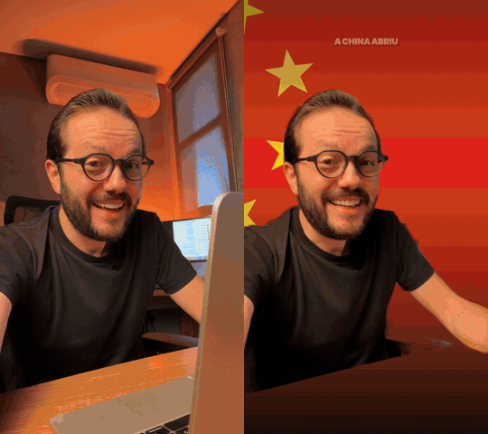
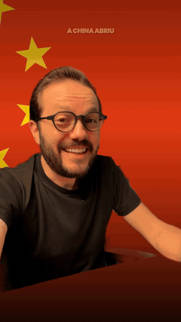
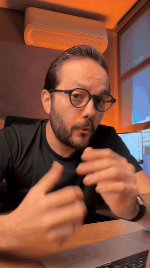
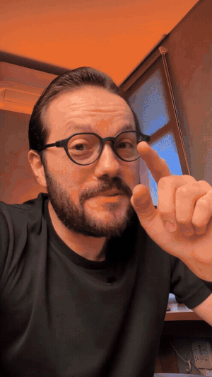
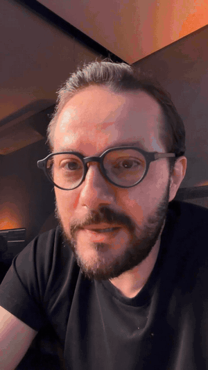
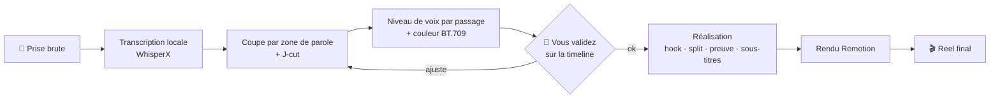

<div align="center">

[🇧🇷 Português](README.md) · [🇺🇸 English](README.en.md) · [🇪🇸 Español](README.es.md) · **🇫🇷 Français**

# 🎬 Reel CCB

### Vous filmez. Claude Code monte le Reel.

Une skill de montage de Reel vertical (talking head 9:16) pour [Claude Code](https://claude.com/claude-code).<br>
Elle coupe les erreurs, équilibre la voix, corrige la couleur et construit le hook, le split screen, la preuve à l'écran et les sous-titres. Le tout à partir d'une phrase dans le terminal.


<br>



<sub><b>À gauche :</b> la prise brute, telle qu'elle sort du téléphone. <b>À droite :</b> le même passage après la skill.</sub>

</div>

---

## Sommaire

- [Ce qu'elle fait sur une vraie prise](#ce-quelle-fait-sur-une-vraie-prise)
- [Galerie](#galerie)
- [Comment ça marche](#comment-ça-marche)
- [Les 3 lois](#les-3-lois)
- [Prérequis](#prérequis)
- [Installation](#installation)
- [Utilisation](#utilisation)
- [Sous le capot : `edit-data.json`](#sous-le-capot--edit-datajson)
- [Contenu du repo](#contenu-du-repo)
- [Pièges déjà gérés](#pièges-déjà-gérés)
- [FAQ](#faq)
- [Dépannage](#dépannage)
- [Contribuer](#contribuer)

> Le Reel de démonstration est en portugais du Brésil. La skill fonctionne dans toutes les langues que Whisper transcrit.

---

## Ce qu'elle fait sur une vraie prise

Le Reel ci-dessus a été monté de bout en bout par la skill. Les chiffres viennent de ce montage :

| | |
|---|---|
| ⏱️ **Durée** | 64,0 s de brut → **53,6 s** de Reel |
| ✂️ **Coupe** | erreurs, reprises et silences retirés selon les zones de parole mesurées dans l'audio, avec des J-cuts entre les blocs |
| 🎚️ **Voix** | niveau corrigé par passage : la voix qui retombe en fin de phrase revient à sa place |
| 🎨 **Couleur** | étalonnage appliqué et re-étiqueté en BT.709 pour ne pas brûler sur Instagram |
| 🧩 **Réalisation** | hook écrit, split screens, texte derrière la personne, preuve à l'écran, sous-titres mot à mot |
| ✅ **Validation** | vous validez la coupe sur une timeline dans le navigateur avant tout graphisme |

---

## Galerie

<table>
<tr>
<td align="center" width="50%"><br><b>Hook derrière la tête</b><br><sub>La frame 1 est déjà la couverture. La personne est détourée et le texte passe derrière elle.</sub></td>
<td align="center" width="50%"><br><b>Split screen</b><br><sub>Les images d'appui passent en bas, le visage ne quitte jamais l'écran.</sub></td>
</tr>
<tr>
<td align="center"><br><b>Preuve à l'écran</b><br><sub>Chaque affirmation vérifiable apparaît au moment où elle est dite.</sub></td>
<td align="center"><br><b>CTA de fin</b><br><sub>Un grand mot-clé, prêt pour l'automatisation des DM.</sub></td>
</tr>
</table>

---

## Comment ça marche



Deux phases, deux skills :

- **`motor-reel` (Phase 1, ingénierie) :** transcrit, trouve les vrais bords de chaque phrase, coupe, raccorde en J-cut, mesure et corrige le niveau de chaque passage, applique la couleur et **vérifie la coupe numériquement** avant que vous la regardiez.
- **`reel-ccb` (Phase 2, réalisation) :** décide de ce qui apparaît à l'écran. Tout le montage tient dans un seul `edit-data.json` ; le template Remotion ne change pas.

---

## Les 3 lois

Chaque Reel qui sort d'ici suit ces trois règles :

1. **La personne ne quitte jamais l'écran.** Moins de 2 % du temps sans elle. Par défaut, c'est le split, pas le b-roll plein écran.
2. **Le fond n'est jamais noir uni.** Chaque overlay utilise l'environnement flouté de la personne.
3. **Les 2 premières secondes montrent la personne qui parle avec le hook écrit derrière elle.** Jamais d'ouverture sur un logo ou un b-roll : la frame 1 est la miniature du feed.

---

## Prérequis

| | |
|---|---|
| Système | macOS (testé). Linux et Windows sont pris en charge par le moteur, mais pas encore testés avec cette skill |
| Agent | [Claude Code](https://claude.com/claude-code) |
| Outils | `ffmpeg`, `uv`, Node.js 18+ |
| Disque | ~2 Go à la première installation (WhisperX + torch) |
| Clé d'API | **aucune** pour couper, transcrire et monter |

---

## Installation

```bash
git clone https://github.com/bisnishub/reel-ccb
cp -R reel-ccb/skills/* ~/.claude/skills/

brew install ffmpeg uv node

cd ~/.claude/skills/motor-reel
uv sync                      # ~2 Go la première fois, 100 % local
uv sync --extra matting      # optionnel : effet « texte derrière la personne »
```

## Utilisation

Ouvrez Claude Code dans le dossier de la vidéo et demandez :

```text
monte ce reel : ./take01.mp4
```

```text
coupe mes erreurs et monte le reel, le hook est « La Chine a ouvert le secret de l'IA »
```

```text
ajoute un split avec ./broll/demo.mp4 quand je dis « dépôt »
```

Claude lance la Phase 1, ouvre la timeline dans le navigateur pour que vous validiez la coupe, puis, après votre ok, construit la Phase 2 et livre `final.mp4`.

---

## Sous le capot : `edit-data.json`

Toute la réalisation d'un Reel tient dans un fichier. Claude l'écrit ; vous pouvez l'ajuster à la main :

```json
{
  "hook": {
    "style": "outline",
    "endSec": 4.0,
    "lines": ["LA CHINE A OUVERT", "LE SECRET DE L'IA"]
  },
  "camera": { "enabled": true, "zooms": [1.1, 1.16, 1.12], "pushIn": 0.04 },
  "captions": { "enabled": true, "style": "karaoke", "maxWords": 3 },
  "splitInserts": [
    { "src": "brolls/demo.mp4", "start": 6.6, "end": 10.6, "fit": "cover", "bandH": 620 }
  ]
}
```

Schéma complet dans [`skills/motor-reel/references/shortform.md`](skills/motor-reel/references/shortform.md).

---

## Contenu du repo

```
skills/
├── reel-ccb/            # réalisation : lois, techniques, rythme, pièges, checklist
│   └── SKILL.md
└── motor-reel/          # moteur : coupe, voix, couleur, vérification, preview, template Remotion
    ├── SKILL.md
    ├── helpers/         # transcribe, speech_regions, voice_levels, verify_cut, render...
    ├── assets/          # interface de preview + templates shortform/longform
    └── references/      # schéma de la Phase 2 et pièges
```

> La skill `reel-ccb` est rédigée en portugais. Claude la lit sans problème et répond dans votre langue.

## Pièges déjà gérés

Chacun a coûté des heures sur un vrai montage. La skill les connaît déjà :

- **Le rendu Remotion revient avec de mauvaises étiquettes couleur** (`pc/bt470bg`, ~20 % plus saturé). La skill le re-étiquette en `tv/bt709`.
- **Le rendu sature déjà** (+0,40 dBTP avant toute musique), donc le loudnorm final est obligatoire.
- **Le timing des overlays vient de `jcut_timeline`**, pas de la somme des segments. La somme décale de 234 ms et chaque graphisme arrive en avance.
- **Les timestamps de Whisper ne sont pas des points de coupe.** Les bords viennent des zones de parole mesurées dans l'audio.

---

## FAQ

<details>
<summary><b>Ça marche dans d'autres langues que le portugais ?</b></summary>

Oui. La transcription est multilingue. Précisez la langue dans votre demande (« monte ce reel en français ») pour que la skill passe `--language fr` et saute l'auto-détection.
</details>

<details>
<summary><b>Faut-il un GPU ?</b></summary>

Non. Ça tourne sur CPU et sur Apple Silicon. La première transcription est plus longue à cause du téléchargement des modèles.
</details>

<details>
<summary><b>Ma vidéo quitte-t-elle ma machine ?</b></summary>

Non. Transcription, coupe et rendu tournent en local. Le seul service externe est Claude lui-même, qui lit le texte de la transcription, pas la vidéo.
</details>

<details>
<summary><b>Ça gère la vidéo horizontale ?</b></summary>

Le moteur prend en charge le 16:9 (template longform). La réalisation de cette skill est pensée pour le 9:16.
</details>

<details>
<summary><b>Je peux l'utiliser avec Codex ou un autre agent ?</b></summary>

Le moteur suit le format standard de skill (`SKILL.md` + `helpers/`). Copiez les dossiers dans le répertoire de skills de votre agent.
</details>

---

## Dépannage

| Symptôme | Cause | Solution |
|---|---|---|
| `ffmpeg: command not found` | ffmpeg absent du PATH | `brew install ffmpeg` |
| `yt-dlp not on PATH` / erreur d'import | venv périmé | `cd ~/.claude/skills/motor-reel && uv sync` |
| Le texte derrière la personne n'apparaît pas | extra matting non installé | `uv sync --extra matting` |
| Reel final plus saturé que la coupe | étiquettes couleur de Remotion | géré par la skill ; vérifiez `final_bt709.mp4` |
| Overlays en avance | `segments.json` additionné à la main | le générer depuis `jcut_timeline` |

---

## Contribuer

Issues et PR bienvenues. Si votre montage a révélé un nouveau piège, ouvrez une issue avec le symptôme et la façon dont vous l'avez mesuré, comme sont rédigés ceux de la skill.

---

<div align="center">

Réalisé par **[Bisnis HUB](https://bisnishub.com.br)**

<sub>Moteur de coupe basé sur <a href="https://github.com/fillrochaa/edvid">edvid</a> (MIT). Licence dans <code>skills/motor-reel/LICENSE</code>.</sub>

</div>
