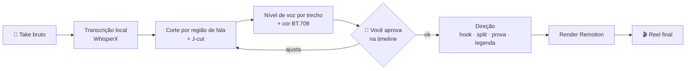

<div align="center">

**🇧🇷 Português** · [🇺🇸 English](README.en.md) · [🇪🇸 Español](README.es.md) · [🇫🇷 Français](README.fr.md)

# 🎬 Reel CCB

### Você grava. O Claude Code edita o Reel.

Skill de edição de Reel vertical (talking head 9:16) para o [Claude Code](https://claude.com/claude-code).<br>
Corta os erros, nivela a voz, corrige a cor e monta hook, split screen, prova na tela e legenda. Tudo a partir de uma frase no terminal.


<br>


<sub><b>Esquerda:</b> o take bruto, do jeito que saiu do celular. <b>Direita:</b> o mesmo trecho depois da skill.</sub>

</div>

---

## Sumário

- [O que ela faz num take real](#o-que-ela-faz-num-take-real)
- [Galeria](#galeria)
- [Como funciona](#como-funciona)
- [As 3 leis](#as-3-leis)
- [Requisitos](#requisitos)
- [Instalar](#instalar)
- [Usar](#usar)
- [Por dentro: o `edit-data.json`](#por-dentro-o-edit-datajson)
- [O que tem no repo](#o-que-tem-no-repo)
- [Gotchas que já vêm resolvidos](#gotchas-que-já-vêm-resolvidos)
- [FAQ](#faq)
- [Problemas comuns](#problemas-comuns)
- [Contribuir](#contribuir)

---

## O que ela faz num take real

O Reel lá de cima foi editado inteiro pela skill. Os números são dessa edição:

| | |
|---|---|
| ⏱️ **Duração** | 64,0s de bruto → **53,6s** de Reel |
| ✂️ **Corte** | erros, regravações e silêncios removidos por região de fala medida no áudio, com J-cut entre blocos |
| 🎚️ **Voz** | nível corrigido por trecho: a voz que cai no fim da frase volta pro lugar |
| 🎨 **Cor** | grade aplicada e reetiquetada em BT.709, pra não estourar no Instagram |
| 🧩 **Direção** | hook escrito, split screens, texto atrás da pessoa, prova na tela, legenda palavra por palavra |
| ✅ **Aprovação** | você aprova o corte numa timeline no navegador antes de qualquer gráfico entrar |

---

## Galeria

<table>
<tr>
<td align="center" width="50%"><br><b>Hook atrás da cabeça</b><br><sub>O frame 1 já é a capa. A pessoa é recortada e o texto passa por trás dela.</sub></td>
<td align="center" width="50%"><br><b>Split screen</b><br><sub>O apoio entra embaixo e o rosto nunca sai da tela.</sub></td>
</tr>
<tr>
<td align="center"><br><b>Prova na tela</b><br><sub>Toda afirmação verificável aparece no momento em que é dita.</sub></td>
<td align="center"><br><b>CTA de fechamento</b><br><sub>Palavra-chave grande, pronta pra automação de DM.</sub></td>
</tr>
</table>

---

## Como funciona



São duas fases, em duas skills:

- **`motor-reel` (Fase 1, engenharia):** transcreve, acha as bordas reais de cada fala, corta, emenda com J-cut, mede e corrige o nível de cada trecho, aplica cor e **verifica o corte numericamente** antes de você assistir.
- **`reel-ccb` (Fase 2, direção):** decide o que aparece na tela. A edição inteira é descrita num único `edit-data.json`, e o template Remotion não muda.

---

## As 3 leis

Todo Reel que sai daqui segue estas três regras:

1. **A pessoa nunca sai da tela.** Menos de 2% do tempo sem ela. O padrão é split, não b-roll em tela cheia.
2. **Fundo nunca é preto chapado.** Todo overlay usa o próprio ambiente borrado.
3. **Os 2 primeiros segundos são a pessoa falando com o hook escrito atrás.** Nunca abre com logo nem b-roll: o frame 1 é a thumb do feed.

---

## Requisitos

| | |
|---|---|
| Sistema | macOS (testado). Linux e Windows são suportados pelo motor, mas ainda não foram testados com esta skill |
| Agente | [Claude Code](https://claude.com/claude-code) |
| Ferramentas | `ffmpeg`, `uv`, Node.js 18+ |
| Disco | ~2 GB na primeira instalação (WhisperX + torch) |
| Chave de API | **nenhuma** para cortar, transcrever e montar |

---

## Instalar

```bash
git clone https://github.com/bisnishub/reel-ccb
cp -R reel-ccb/skills/* ~/.claude/skills/

brew install ffmpeg uv node

cd ~/.claude/skills/motor-reel
uv sync                      # ~2 GB na 1ª vez, roda 100% local
uv sync --extra matting      # opcional: efeito "texto atrás da pessoa"
```

## Usar

Abra o Claude Code na pasta do vídeo e peça:

```text
edita esse reel: ./take01.mp4
```

```text
corta meus erros e monta o reel, o hook é "A China abriu o segredo da IA"
```

```text
coloca um split com ./broll/demo.mp4 quando eu falar "repositório"
```

O Claude roda a Fase 1, abre a timeline no navegador pra você aprovar o corte e, depois do ok, monta a Fase 2 e entrega o `final.mp4`.

---

## Por dentro: o `edit-data.json`

A direção inteira de um Reel cabe num arquivo. O Claude escreve, você pode ajustar na mão:

```json
{
  "hook": {
    "style": "outline",
    "endSec": 4.0,
    "lines": ["A CHINA ABRIU", "O SEGREDO DA IA"]
  },
  "camera": { "enabled": true, "zooms": [1.1, 1.16, 1.12], "pushIn": 0.04 },
  "captions": { "enabled": true, "style": "karaoke", "maxWords": 3 },
  "splitInserts": [
    { "src": "brolls/demo.mp4", "start": 6.6, "end": 10.6, "fit": "cover", "bandH": 620 }
  ]
}
```

O schema completo está em [`skills/motor-reel/references/shortform.md`](skills/motor-reel/references/shortform.md).

---

## O que tem no repo

```
skills/
├── reel-ccb/            # a direção: leis, técnicas, ritmo, gotchas, checklist
│   └── SKILL.md
└── motor-reel/          # o motor: corte, voz, cor, verificação, preview, template Remotion
    ├── SKILL.md
    ├── helpers/         # transcribe, speech_regions, voice_levels, verify_cut, render...
    ├── assets/          # interface de preview + templates shortform/longform
    └── references/      # schema da Fase 2 e gotchas
```

## Gotchas que já vêm resolvidos

Cada um destes custou horas numa edição real. A skill já sabe deles:

- **O render do Remotion volta com cor errada** (`pc/bt470bg`, uns 20% mais saturado). A skill reetiqueta pra `tv/bt709`.
- **O render já chega clipando** (+0,40 dBTP antes da trilha), então o loudnorm final é obrigatório.
- **O tempo dos overlays vem do `jcut_timeline`**, não da soma dos segmentos. Somar erra 234ms e todo gráfico entra adiantado.
- **Timestamp do Whisper não serve pra cortar.** As bordas vêm da região de fala medida no áudio.

---

## FAQ

<details>
<summary><b>Funciona em outro idioma além de português?</b></summary>

Sim. A transcrição é multilíngue. Diga o idioma no pedido ("edita esse reel em inglês") pra skill passar `--language en` e pular a auto-detecção.
</details>

<details>
<summary><b>Precisa de GPU?</b></summary>

Não. Roda em CPU e em Apple Silicon. A primeira transcrição demora mais por causa do download dos modelos.
</details>

<details>
<summary><b>Meu vídeo sai do servidor?</b></summary>

Não. Transcrição, corte e render rodam na sua máquina. O único serviço externo é o próprio Claude, que lê o texto da transcrição, não o vídeo.
</details>

<details>
<summary><b>Serve pra vídeo horizontal?</b></summary>

O motor suporta 16:9 (template longform). A direção desta skill foi pensada pra 9:16.
</details>

<details>
<summary><b>Posso usar no Codex ou em outro agente?</b></summary>

O motor segue o formato de skill padrão (`SKILL.md` + `helpers/`). Copie as pastas pro diretório de skills do seu agente.
</details>

---

## Problemas comuns

| Sintoma | Causa | Correção |
|---|---|---|
| `ffmpeg: command not found` | ffmpeg fora do PATH | `brew install ffmpeg` |
| `yt-dlp not on PATH` / erro de import | venv desatualizado | `cd ~/.claude/skills/motor-reel && uv sync` |
| Texto atrás da pessoa não aparece | extra de matting não instalado | `uv sync --extra matting` |
| Reel final mais saturado que o corte | tags de cor do Remotion | já tratado na skill; confira `final_bt709.mp4` |
| Overlay entrando adiantado | `segments.json` somado na mão | gerar a partir do `jcut_timeline` |

---

## Contribuir

Issues e PRs são bem-vindos. Se a sua edição achou um gotcha novo, abra uma issue com o sintoma e como mediu, do mesmo jeito que estão escritos os da skill.

---

<div align="center">

Feito pela **[Bisnis HUB](https://bisnishub.com.br)**

<sub>Motor de corte baseado no <a href="https://github.com/fillrochaa/edvid">edvid</a> (MIT). Licença em <code>skills/motor-reel/LICENSE</code>.</sub>

</div>
